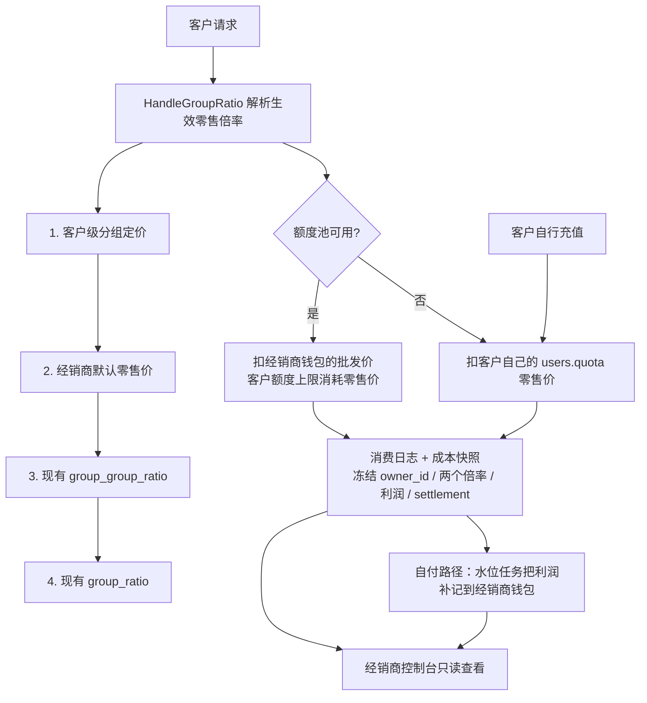

# 按用户分组定价与经销商系统：技术设计方案

设计基线：v1.0，2026-10-18。源码基线 `05915b6c6`（`main`），对照上游 `new-api` 本地镜像 HEAD `1b63c28dc`。

本文只描述方案，不包含已实现代码。所有 `文件:行号` 引用均来自本轮只读核对；未核对生产数据库、真实流量与线上配置。参照实现为 `/root/miaosha-router/new-realm-api` 的 `agent` 子系统，仅作业务语义参考。

## 1. 结论与范围

两个需求合并为一套定价层，加一层独立的经销商归属与分成：

| 能力 | 实现方式 | 触碰上游计费逻辑 |
| --- | --- | --- |
| 单个用户按分组单独定价 | 新表 + `HandleGroupRatio` 内新增一层查找 | 约 6 行 |
| 经销商给客户设零售价 | 同上，写同一张表，仅权限不同 | 0（复用上一行） |
| 平台给经销商设成本价 | 新表 + 快照写入时算分成 | 0 |
| 客户归属经销商 | 关系表（当前值 + 追加式历史） | 0 |
| 逐笔利润 | 成本快照新增列，写时冻结 | 0 |
| 客户自行充值 | 现有充值链路 | 0 |
| 经销商给客户加额度 | 额度上限表（数字，不动资金） | 0 |
| 客户自行充值后继续可用 | 池耗尽自动回落自付 | 0 |
| 经销商利润 | 池路径自然沉淀 + 自付路径水位入账 | 0 |
| 经销商只读控制台 | 新查询 + 汇总表 + 现有脱敏函数 | 0 |

**明确不采用的方案**见第 10 节：共享余额池（付款人 ≠ 被计费用户）与纯批发转售。

## 2. 现状与复用边界

| 当前代码 | 已有能力或事实 | 本功能的处理方式 |
| --- | --- | --- |
| [relay/helper/price.go](../../relay/helper/price.go) `HandleGroupRatio` | 全系统唯一倍率收敛点（`:45`）；先查 `(UserGroup, UsingGroup)` 特例（`:59`），否则回退分组倍率（`:67`） | 新增一层用户级查找，**唯一必须修改的计费函数** |
| [setting/ratio_setting/group_ratio.go](../../setting/ratio_setting/group_ratio.go) | `group_ratio` / `group_group_ratio` 运行时热更新 RWMap，注册于 `:51` | 不改；新数据放独立表 |
| [service/group.go](../../service/group.go) `GetUserUsableGroups` | 分组准入是运行时字典（`:14`） | 复用；经销商客户不新增分组，不改 `abilities` 路由 |
| [model/billing_ledger.go](../../model/billing_ledger.go) | append-only 单主体账本（`:48`）；`appendBillingEntry`（`:170`）、`changeBillingWallet`（`:210`）、`PostBillingAdjustment`（`:307`）；`funding` 不进客户账单（`:184`） | 池路径的批发扣款与自付利润入账都走这套账；**该文件下游独有** |
| [model/cost_accounting.go](../../model/cost_accounting.go) | 每请求一条不可变成本快照（`:32`），`RevenueQuota` / `CostQuota` 分列；利润现算（`:472`）；过滤器在 `:398` | 加归属与分成列，写时冻结；**该文件下游独有** |
| [model/log.go](../../model/log.go) | 消费日志与成本快照在同一处写入（`:422`、`:483`）；`formatUserLogs` 是唯一的非管理员脱敏投影（`:122`） | 复用脱敏；控制台明细直接从主库快照查询，不依赖日志库 |
| [service/task_billing.go](../../service/task_billing.go) | 任务完成按 token 重算（`:343`），但倍率用 `(group, group)` 自映射（`:370`） | 一并修正，改用提交时冻结的倍率 |
| [controller/relay.go](../../controller/relay.go) | 任务提交时把生效倍率冻结进 `BillingContext`（`:722`） | 直接复用冻结值，不新增冻结逻辑 |
| [model/user.go](../../model/user.go) | 钱包 `users.quota` 为 `int`（`:99`）；改 `group` 会递增 `AuthVersion`（`:974`） | 经销商能力**不写 `users.group`**，避免顶掉登录会话 |
| [model/billing_correction_apply.go](../../model/billing_correction_apply.go) | 更正追加 `rate_correction` 分录并写独立成本快照（`:181`） | 更正快照同步冻结归属与分成 |
| [service/system_task.go](../../service/system_task.go) | 系统任务框架带租约、跨节点去重（`:57`） | 用于每日汇总任务 |
| [service/authz/registry.go](../../service/authz/registry.go) | 权限资源注册表（`:22`），但默认角色解析低于管理员返回空 | 经销商鉴权独立中间件，不改角色解析 |
| [pkg/cachex](../../pkg/cachex) | Redis / 内存混合缓存，`model/subscription.go` 已在用 | 复用为定价与归属的读缓存 |

**关键约束：** `BillingEntry` 每行只有一个 `UserID`，没有对手方字段（`model/billing_ledger.go:48`）。因此分成不能「一笔消费记两个人」，只能是「从既有消费派生一笔独立应付」——这正是本方案全部资金设计的出发点。

## 3. 推荐架构



核心原则：

1. **全平台只有一本钱包、一个计费会话。** 客户付自己的钱。经销商不持有第二个钱包，也不参与任何请求的扣费。
2. **利润是派生量，逐笔冻结。** 不重算、不追溯；客户过户或经销商改价只影响之后的请求。
3. **经销商是用户之上的一层归属与定价。** 主链路不知道经销商存在。
4. **零售价与成本价分属两方。** 经销商定零售，平台定成本；平台不校验零售是否高于成本。

## 4. 数据模型

全部为新增表；既有表只追加空列与索引，旧行保持 0/空值。

### 4.1 `reseller_profiles` 经销商档案

| 列 | 类型 | 说明 |
| --- | --- | --- |
| `id` | 主键 | |
| `user_id` | int，唯一索引 | 经销商对应的平台用户，复用其登录与钱包 |
| `name` / `code` | varchar | 展示名与可选编码 |
| `status` | int | `1` 停用 / `2` 启用 |
| `created_at` / `updated_at` | bigint | |

档案只是能力开关，**不携带任何余额字段**：经销商的钱就是其 `users.quota`。

### 4.2 `reseller_group_costs` 平台批发价

`(reseller_id, group_name)` 复合唯一。`cost_ratio` 为十进制字符串，`enabled` 停用即视为未配置批发价。没有批发价的经销商不能开池：其客户走自付路径。

### 4.3 `reseller_default_prices` 经销商默认零售价

`(reseller_id, group_name)` 复合唯一。改一次立即影响名下所有**没有单独定价**的客户；缓存整体失效（`Purge`），不逐客户清理。

### 4.4 `customer_group_prices` 客户级分组定价

`(user_id, group_name)` 复合唯一，`ratio` 为十进制字符串，`source` ∈ `admin` / `reseller` 仅作审计。管理员可给任意用户设；经销商只能给名下客户设。**优先级最高。**

### 4.5 `reseller_customer_bindings` / `reseller_customer_events`

前者为当前归属（`customer_user_id` 主键，`reseller_id = 0` 表示平台直属）；后者为不可变历史（`BeforeUpdate` / `BeforeDelete` 直接返回 `ErrBillingEvidenceImmutable`）。过户只由管理员发起，**不因过户重算历史快照**。

### 4.6 `reseller_customer_allocations` 额度池上限

| 列 | 说明 |
| --- | --- |
| `customer_user_id` | 主键 |
| `allocated_quota` | 经销商授予的零售额度上限 |
| `reserved_quota` | 在途请求的预留（防止并发超授信） |
| `used_quota` | 已结算消耗 |

`AvailableQuota() = max(0, allocated − reserved − used)`。**这是额度上限，不是钱**：分配与回收都不产生任何资金流水，也不会让客户余额变负。

### 4.7 `reseller_allocation_reservations` 在途预留

`request_id` 主键，记录 `retail_quota` / `wholesale_quota` / `state`（`open` / `settled` / `released`）。

它同时承担两件事：预扣幂等（同一 `request_id` 重试不会二次预留）和结算依据（按实际零售额与预留批发额的差额补扣或退还）。

### 4.8 `reseller_margin_credit_cursors` 入账水位

`owner_id` 主键 + `last_snapshot_id`。自付路径的利润按水位增量入账，事件键由水位区间生成（`reseller:margin:<owner>:<lastSnapshotId>`），崩溃重放同一区间是幂等空操作。

### 4.9 `reseller_margins_daily` 每日汇总

`(owner_id, day, customer_user_id, model_name)` 复合唯一。表已建好作为后续报表的增量载体；当前控制台在 31 天窗口内直接聚合快照，避免再做一次双写对账。

### 4.10 成本快照追加列（`cost_accounting_snapshots`）

| 列 | 说明 |
| --- | --- |
| `owner_id` | 请求发生时的归属；平台直属为 0；索引 `(owner_id, occurred_at)` |
| `reseller_margin_quota` | 冻结利润，符号随消费/退款 |
| `retail_ratio` / `reseller_cost_ratio` | 冻结的两个倍率 |
| `reseller_settlement` | `pool` / `self` / `correction`，决定这条利润是否还需入账 |

`pool` 的利润在扣款时已自然沉淀在经销商钱包（只扣批发价），**不能再入账一次**；只有 `self` 由水位任务补记。这个字段就是防止重复入账的开关。

## 5. 定价查找链与生效点

### 5.1 查找优先级

```
① customer_group_prices(user_id, using_group)            客户单独定价
② reseller_default_prices(owner_id, using_group)         经销商默认零售价
③ ratio_setting.GetGroupGroupRatio(user_group, using_group)
④ ratio_setting.GetGroupRatio(using_group)
```

- 平台直属客户（`owner_id = 0`）跳过 ①②，行为与改造前完全一致。
- 未配置批发价（`cost_ratio` 为空或 ≤ 0）时命中 ①② 仍按零售价计费，但走**自付**路径（客户自己的钱包），利润由水位任务补记。

### 5.2 生效点（单一入口）

`HandleGroupRatio`（`relay/helper/price.go`）在现有 if/else 之后调用 `applyResellerPricing`：

- 命中时同时写 `GroupSpecialRatio` / `GroupRatio` / `HasSpecialRatio`，日志与展示自动一致；
- 同时把 `ResellerOwnerID` / `ResellerRetailRatio` / `ResellerCostRatio` / `ResellerPath` 冻结到 `RelayInfo`，供资金路由与快照证据使用。

`HandleGroupRatio` 的三处调用方（`price.go` 的按量与按次、`controller/relay.go` 的任务提交）因此全部自动继承。

### 5.3 展示与对账收敛

| 位置 | 处理 |
| --- | --- |
| `controller/pricing.go` | 改为逐个分组调用统一解析 |
| `controller/group.go` + `service/group.go` | `GetUserGroupRatio(userID, userGroup, group)` 统一解析 |
| `service/quota.go` 实时语音预扣 | 读 `RelayInfo` 上已冻结的倍率，不再自行复刻两级查找 |
| `service/task_billing.go` 任务重算 | 直接用 `BillingContext.GroupRatio` 冻结值（见 9.3） |

### 5.4 明确不做

- 不把用户挂到独立分组定价：分组同时是路由键（`abilities`），会成倍复制行。
- 不改 `tokens.group`：它是运营手段，不是定价维度。
- 不改 `users.group`：会递增 `AuthVersion` 并撤销会话，批量接入客户时是可感知的运营动作。

## 6. 单笔分成与更正

### 6.1 计算

记原价基准 `B = 零售实扣 ÷ 零售倍率`（这一关系由成本侧既有逻辑保证：`service/cost_accounting.go:73-81`、`:107`）。

```
分成 = 零售实扣 − B × 成本倍率
     = 零售实扣 × (1 − 成本倍率 / 零售倍率)
```

写入时机与成本快照同点（`model/log.go:422`、`:483`），因此与日志严格同事务、同请求。

### 6.2 冻结

`owner_id` 与两个倍率在写入时确定，此后不随改价或过户改变。经销商改价只影响之后的请求；客户过户只影响之后的请求。这是账务正确性要求，不是实现取舍。

### 6.3 更正与退款

- 退款/补扣产生负值快照时，分成自动按同公式变成负值，不需要单独处理。
- 更正走 `rate_correction`：`model/billing_correction_apply.go:181` 会追加一条独立的成本快照。该处复用既有的「定位原始快照」逻辑（`model/billing_correction_cost.go:247-278` 已按日志四元组 + 时间窗匹配），从原快照复制 `owner_id`、`retail_ratio`、`reseller_cost_ratio`，再按 `delta` 计算分成差额。
- **若原始快照无法定位**：分成记 0，并在批次审计日志中标记 `margin_unresolved`。不猜、不按当前归属回填，避免把历史分成记到错误的人头上。
- 已结算期间不受更正影响。更正产生的负分成进入下一期结算，与「已支付金额不可逆」一致。

### 6.4 平台侧利润

平台毛收入 = `B × 成本倍率`，平台净利 = `B × 成本倍率 − 渠道真实成本`。前者已包含在快照的 `RevenueQuota` 与 `reseller_margin_quota` 之间，后者沿用现有 `CostQuota`。平台利润仍在现有成本会计里查看，经销商永远看不到这两个数。

## 7. 资金流

全平台只有一套钱包：`users.quota` 加追加式 `billing_ledger`。经销商不是第二套账，而是这层账上的一个付款方。

### 7.1 两条资金来源，一个价格

客户每笔请求按 5.1 解析出的零售价计费，资金来源二选一：

| 路径 | 谁付 | 扣多少 | 利润如何体现 |
| --- | --- | --- | --- |
| 池（`pool`） | 经销商钱包 | 批发价 `零售 × c / r` | 差额天然留在经销商钱包 |
| 自付（`self`） | 客户自己的钱包 | 零售价 | 按水位任务把利润补记到经销商钱包 |

选择规则：`owner_id > 0` 且配置了批发价、且 `AvailableQuota() >= 本次预扣` 时走池；否则走自付。**额度池耗尽只是回落到自付，不会发生任何借贷，也不会超授信。**

### 7.2 池路径的三步

1. **预留**：同一事务内锁客户额度行 → 校验 `available >= 零售预扣` → 锁经销商钱包 → 扣批发价 → 累加 `reserved` → 写 `open` 预留。任一步失败则整体回滚。
2. **结算**：按实际零售额重算批发额，差额补扣或退还；`reserved → used`。
3. **退款**：请求失败时释放预留，批发额原路退回。

经销商钱包不足时**直接拒绝**（`reseller wallet insufficient`），不静默回落到客户钱包——否则等于平台替经销商垫资。

流水一律用 `Kind="funding"`：不进入任何客户的消费账单，也不会被当成消费统计。事件键由服务端生成，重放安全。

### 7.3 自付路径的利润入账

水位任务按 `owner_id` 读取 `reseller_settlement = 'self'` 的快照，累计 `reseller_margin_quota`，以 `PostBillingAdjustment(Kind="funding")` 记入经销商钱包。`funding` 方向自由、`Quota` 恒为 0，因此既不进账单也不会被计为消费。

退款产生负利润时同一任务自然冲减，不需要单独的退补流程。

### 7.4 客户自行充值

零改动。客户是普通用户，充值进入自己的 `users.quota`；池额度耗尽后自动由这笔余额继续付费。

### 7.5 提现

**不做。** 利润以额度形式留在经销商钱包，平台与经销商之间的现金结算在线下完成，平台侧只改余额。这符合「全平台只有一套余额与计费体系」。

## 8. 经销商控制台与查询

### 8.1 数据来源与性能

| 视图 | 数据来源 | 约束 |
| --- | --- | --- |
| 首页（今日/本月汇总） | `cost_accounting_snapshots` 按 `owner_id` 聚合 | 走 `(owner_id, occurred_at)` 索引 |
| 趋势图 | 同上按天聚合 | 窗口 ≤ 31 天 |
| 明细列表 | `cost_accounting_snapshots`，索引 `(owner_id, occurred_at)` | 时间窗必须 ≤ 31 天；游标翻页；**不执行 `COUNT(*)`** |
| 客户列表 | `reseller_customer_bindings` + 用户表 + 额度表 | 游标分页 |
| 价格簿 | `reseller_group_costs` + `reseller_default_prices` | 单表单行 |

- 明细查询直接走主库，**不查日志库**：日志库可能与主库分离，且 ClickHouse 下 `Log.Id` 不可靠（`model/log.go:574-576`）。
- 汇总与明细都按 `(owner_id, occurred_at)` 索引小范围聚合；自付路径的利润入账由系统任务按水位增量补记。
- 所有查询都必须带 `owner_id`，不接受客户端传入的 `owner_id`。

### 8.2 脱敏

- 复用 `model/log.go:122` 的 `formatUserLogs` 思路，但**不要直接调用它**：它会清空渠道名却保留 `ChannelId`（`model/log.go:75`），对经销商仍属泄露。
- 新增投影函数，白名单输出：时间、客户用户名、模型、请求类型、token 数、零售实扣。剔除渠道 id、上游请求 id、令牌 id、IP、`Other` 中的 `admin_info`、`request_body`、以及所有成本字段。
- 成本与平台利润字段从一开始就不进入经销商 DTO。

### 8.3 鉴权

- 新增中间件：读 `reseller_profiles` + 缓存，确认启用后在上下文写入 `reseller_id`；不是经销商一律 403。
- 不修改 `service/authz` 的角色解析（低于管理员当前返回空，改动会影响全部权限判定）。
- 每个业务接口二次校验资源归属（客户 `reseller_id` 必须等于上下文中的值），不只是路由级门禁。

## 9. 对既有文件的改动清单

### 9.1 上游文件（必须逐条论证）

| 文件 | 改动 | 为什么绕不开 |
| --- | --- | --- |
| [relay/helper/price.go](../../relay/helper/price.go):45-71 | `HandleGroupRatio` 追加一层查找，约 6 行 | 全系统唯一倍率收敛点，且没有计费 hook / 插件注册表；从外部无法改变它的返回值 |
| [service/task_billing.go](../../service/task_billing.go):369-377 | 优先使用 `BillingContext.GroupRatio`，约 4 行，见 9.3 | 任务完成后按 token 重算会丢弃用户级价格 |
| [model/main.go](../../model/main.go):324、:413 | AutoMigrate 注册新表 | 新表必须注册 |
| [router/main.go](../../router/main.go):15-19 | 挂载经销商路由文件 1 行 | 新接口必须挂载 |
| [controller/pricing.go](../../controller/pricing.go):50、[controller/group.go](../../controller/group.go):36 | 改用统一解析函数，各 2~3 行 | 否则展示价与实扣价不一致 |
| 前端路由表 / 侧边栏 / 语言包 | 新增入口与文案 | 纯新增 |

合计约 15 行生产逻辑改动（`HandleGroupRatio` 6 + 任务重算 4 + 展示 5）。

### 9.2 下游独有文件（可自由修改）

`model/billing_ledger.go`、`model/billing_correction_apply.go`、`model/cost_accounting.go`、`service/cost_accounting.go` 均不在上游 new-api 中（逐文件 `diff` 已确认），修改不会产生同步冲突。

### 9.3 D5：任务 token 重算的倍率

**现状：** 任务提交时按生效倍率预扣并冻结（`controller/relay.go:722-724`）；完成后若上游返回真实 token，会重算（`service/task_polling.go:700-725` → `service/task_billing.go:343`）。重算使用 `GetGroupGroupRatio(group, group)`（`:370`），**丢弃了用户所在分组**。

**后果：** 例：`group_group_ratio["vip"]["default"] = 0.8`，提交扣 0.8 倍，完成重算回退到 1.0，补扣 0.2 倍。加入客户级定价后更严重：单独定价的客户在视频任务上会被改回全局价。

**成因：** 上游 `new-api/service/task_billing.go:409` 有完全相同的代码，属上游既有缺陷；上游 `TaskBillingContext` 早已包含 `GroupRatio`（`new-api/model/task.go:166`），只是重算时未使用。

**修法：**

```go
finalGroupRatio := 0.0
if bc := task.PrivateData.BillingContext; bc != nil {
    finalGroupRatio = bc.GroupRatio // 提交时冻结的生效倍率
}
if finalGroupRatio <= 0 {
    // 旧任务缺少冻结值，保留原逻辑
}
```

**影响面：** 只改变「设了特殊倍率或客户级定价、且任务返回 token」的任务，方向是让完成后的价格与提交时一致。按次计费任务本就跳过重算（`service/task_polling.go:707`）。现有断言旧行为的测试需同步更新。

**建议：** 作为独立提交，并向上游提交同样修复；上游合并后此差异归零。

### 9.4 下游差异台账

按 `AGENTS.md` 的治理规则，本方案改变计费与授权边界，实施 PR 时在 `README.md` 的差异台账（`README.md:78-121`）新增一行，写明真实 PR 链接、日期、影响面与上游关系。本轮只出设计文档，不添加占位行。

## 10. 明确不采用的方案

### 10.1 让客户余额就是经销商余额的一部分

即客户没有自己的钱包、每次调用直接扣经销商的 `users.quota`。

**不采用的原因：**

1. 付款人 ≠ 被计费用户，`BillingEntry` 只有单一 `UserID`（`model/billing_ledger.go:48`），一笔扣费无法同时记在两个人头上。
2. 客户不能自行充值——充值会落进一个不存在的钱包。
3. 客户没有自己的账本，平台无法为其出对账单。
4. 不设上限时，平台实际上在替经销商无限垫资。

**最终采用的折中：** 客户保留钱包与账本，经销商通过**额度上限**（`reseller_customer_allocations`）控制客户能从池里用多少，批发放款仍从经销商钱包扣。上限是数字，不是钱，因此既不产生第二套余额，也不会出现负余额。

### 10.2 纯批发转售

经销商按成本价批发额度再零售。平台看不到零售价，记不下逐笔利润，也无法给客户出用量视图，不满足需求。

### 10.3 平行计费会话

另开一套「经销商计费会话」与主链路并行。会让同一笔请求出现两份预扣、两份结算，退补难以对齐，且与 `BillingSession` 的信任旁路、订阅回退逻辑重复。最终选择在既有 `FundingSource` 接口内新增一种实现。

## 11. 实施路线与当前状态

每个阶段可独立发布、独立回滚；回滚都是「停用新表读写 / 清空定价表」，不涉及数据回迁。

### P0 地基 —— 已完成

新表与迁移注册、成本快照加列、定价解析器与缓存、归属与额度池的模型层。

### P1 定价收敛 —— 已完成

- `HandleGroupRatio` 接入经销商定价；`controller/pricing.go`、`controller/group.go`、`service/group.go` 统一到同一解析器。
- D5 修正：任务 token 重算改用提交时冻结的 `BillingContext.GroupRatio`。
- 实时语音预扣改用 `RelayInfo` 上冻结的倍率。

### P2 资金与账务 —— 已完成

- `ResellerFunding` 接入 `NewBillingSession`：池路径优先，额度不足回落自付；信任旁路对池路径强制关闭。
- 预留 / 结算 / 退款带行锁与幂等键；经销商钱包不足直接拒绝。
- 快照冻结 `owner_id`、两个倍率、利润与结算路径；更正快照同口径。
- 任务提交冻结经销商倍率；按日利润水位任务注册为系统任务。

### P3 接口层 —— 已完成

- 管理员：经销商档案、批发价、默认零售价、客户单独定价（`PUT /api/user/:id/group-pricing`）、归属变更、额度池调整。
- 经销商控制台：首页汇总、客户列表、创建客户、额度调整、客户定价、用量明细（31 天窗口 + 游标 + 无 `COUNT`）、利润日汇总、价格簿。
- 越权一律 403：只能访问名下客户；归属变更仅管理员。

### P4 前端与控制台界面 —— 未开始

- `web/` 的定价抽屉、经销商档案与客户管理界面、控制台页面。
- 需要 `bun` 构建与交互评审，按 `web/AGENTS.md` 单独一轮。

### P5 压测与差异台账 —— 未开始

- 百万级快照下的控制台查询压测；三数据库回归。
- `README.md` 差异台账条目（需真实 PR 链接，暂不预填）。

## 12. 风险与边界

| 风险 | 影响 | 缓解 |
| --- | --- | --- |
| 热路径缓存未命中 | 每个请求多一次查询 | 短 TTL + 精确失效；命中率为 0 时仍有主键查询兜底 |
| 六处倍率逻辑再次分叉 | 展示价 ≠ 实扣价 | 统一解析函数；P1 验收强制四处一致 |
| 更正无法定位原快照 | 分成少记 | 记 0 + 审计标记，绝不按当前归属回填 |
| 分成重复计入 | 多付 | 快照 `event_key` 唯一；`reseller_settlement` 区分池/自付，池路径不再入账 |
| 利润水位重放 | 重复入账 | 事件键由水位区间生成，重放为幂等空操作 |
| 预留并发 | 超授信 | 单事务 + 行锁 + `open` 状态机 |
| 上游合并冲突 | 同步成本 | 改动集中在两个函数的纯新增分支；D5 同步上游后归零 |
| 大表查询变慢 | 控制台卡顿 | 31 天窗口、游标、无 COUNT、只走主库索引 |

**已知限制：**

- 经销商客户的平台月度对账单（`BillingStatement`）不包含经销商归属信息；客户对账以消费日志为准。若后续需要，可从成本快照派生，属独立需求。
- 平台与经销商之间的现金结算在线下完成，平台侧只调整余额，不提供提现流程。
- 未做多币种；金额单位沿用 quota。

## 13. 测试与验收要点

已落地（`go test ./model/ ./service/ ./relay/helper/`）：

- 定价四层优先级：客户价 > 经销商默认价 > 分组专项 > 分组基础；未配置时不覆盖既有链路。
- 池路径金额：`批发 = 零售 × c / r`，`利润 + 批发 = 零售`，退款符号相反。
- 不超授信：超出可用额度的预留被拒绝，`AvailableQuota` 永不为负；上限不得低于已预留与已用。
- 经销商钱包不足：直接拒绝，且不消耗客户额度。
- 预留幂等：同一 `request_id` 重复预扣/结算/退款都不会二次扣款或二次退款。
- 结算：`reserved → used`，批发差额补扣；重复结算为空操作。
- 归属历史：追加式，回收后可重新分配。

待补（P5）：

- 三数据库迁移与关键事务回归。
- 百万级快照下控制台查询走 `(owner_id, occurred_at)` 索引、无 `COUNT`。
- 前端改价后定价页与实扣一致。

## 14. 待确认事项

1. 经销商创建客户时是否允许设置初始邮箱，还是仅用户名 + 密码（当前实现为后者）。
2. `reseller_margins_daily` 目前只建表未写入；控制台在 31 天窗口内直接聚合快照。数据量继续增长后是否需要切换到增量表。
3. 自付路径的利润入账频率（当前系统任务默认 1 分钟一批，可由 `RESELLER_MARGIN_CREDIT_INTERVAL_MINUTES` 调整）。

## 15. 执行摘要

把「按用户定价」与「经销商」做成同一层：客户仍用自己的 `users.quota` 付费，全平台只有一本钱包、一本账；经销商是这层账上的付款方与定价方。

- **池路径**：客户消耗额度上限，平台按批发价扣经销商钱包，差额天然留在经销商钱包。
- **自付路径**：额度用尽或未配批发价时，客户用自己的余额按零售价付费，利润由水位任务补记给经销商。
- 两条路径都**不产生平行账本、不产生第二套余额、不散布类型断言**。

**改动量**：上游生产逻辑约 20 行（`HandleGroupRatio` 接入、任务重算修正、展示解析收敛、会话工厂一处分支），其余全部是新增文件。

**最大风险**：六处倍率解析如果再次分叉，展示价与实扣价会不一致；已收敛到单一解析函数并有回归测试。

